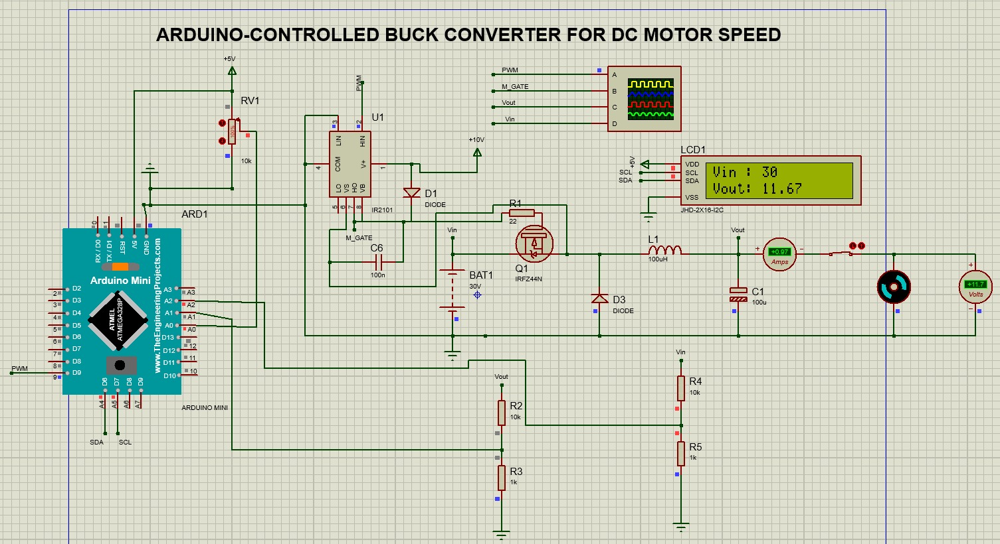
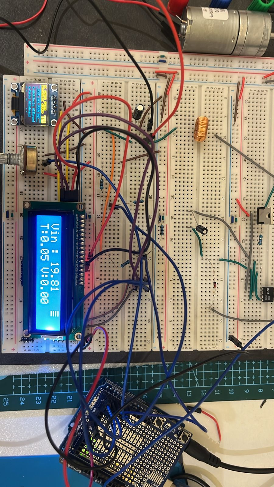

# Arduino-Controlled Buck Converter for DC Motor Speed Control

An academic power electronics project using an Arduino-controlled buck converter to vary the voltage applied to a brushed DC motor. The project includes a Proteus simulation design and a breadboard prototype.

**Repository status:** original Arduino source, an existing HEX build, editable Proteus project, and photographs are included. Compilation and simulation have not been run. The existing HEX has not been verified to match the current sketch.

## How it works

A potentiometer sets a voltage reference up to approximately 12 V. The Arduino measures the output through a resistor divider and incrementally adjusts PWM to reduce the voltage error. An IR2101 drives a high-side IRFZ44N MOSFET; an inductor, capacitor, and freewheeling diode form the buck power stage. An LCD displays voltage information.

The feedback variable is **output voltage**. No RPM sensor or measured speed feedback is documented, so this is voltage regulation used to influence motor speed, rather than verified closed-loop RPM regulation.

## Reported configuration

| Item | Simulation | Hardware |
| --- | --- | --- |
| Controller | Arduino Mini, ATmega328P | Arduino Uno R3 |
| Input voltage | 12-50 V claimed; attached schematic shows 30 V | 12-20 V stated; experimental readings near 19.86 V |
| Target voltage | Up to 12 V | Up to approximately 12 V |
| PWM frequency | 31.25 kHz stated | 31.25 kHz stated; timer prescaler changed in source, frequency unmeasured |
| MOSFET / driver | IRFZ44N / IR2101 | IRFZ44N / IR2101 stated |
| Inductor | 100 uH | 100 uH stated |
| Output capacitor | 100 uF in schematic | Electrolytic; installed value unverified |
| Bootstrap capacitor | 100 nF | 10 uF stated |
| Voltage dividers | 10 kohm upper / 1 kohm lower | Values need confirmation against hardware |
| Display | 16x2 I2C LCD | 16x2 LCD with I2C adapter stated |

These are source-reported values, not independently verified operating ratings. The stated 5 A design target is not a demonstrated continuous-current capability.

## Experimental observations

Previously documented experimental values:

| Reference (V) | Input (V) | Reported output (V) |
| ---: | ---: | ---: |
| 0.00 | 19.86 | 0.00 |
| 3.00 | 19.86 | 3.00 |
| 6.01 | 19.86 | 6.01 |
| 9.00 | 19.85 | 9.00 |
| 12.00 | 19.86 | 12.00 |

The separate photograph near the maximum setting displays target/output values of **11.99 V**, whereas the documented experimental values round the maximum to 12.00 V. LCD readings alone do not establish measurement accuracy, ripple, efficiency, or transient behavior. **The recovered sketch substitutes the target for the displayed output when the measured error is below 0.8 V, and displays zero for a target below 0.1 V. Matching target/output readings therefore do not independently demonstrate tracking accuracy.**

Percentages of 0%, 25%, 50%, 75%, and 100% describe **reference settings**; actual converter duty depends on input voltage, output voltage, losses, and feedback. No actual PWM-duty measurements are supplied.

## Files

- [Original Arduino sketch](firmware/sketch_may16a/sketch_may16a.ino)
- [Editable Proteus project](simulation/copyProject.pdsprj)
- Existing HEX build in `firmware/sketch_may16a/build/arduino.avr.uno/`
- [Schematic image](docs/images/proteus-schematic.png)
- [Prototype photograph](docs/images/hardware-prototype.png)
- [Evidence notes and missing files](docs/PROJECT-NOTES.md)
- LCD photographs in `docs/images/`, named by displayed reference setting.

Original supplied images are preserved without modification.

## Reproducing the project

The recovered sketch targets AVR Arduino hardware and uses `Wire`, `SPI`, `LiquidCrystal_I2C`, `Adafruit_GFX`, and `Adafruit_SSD1306`. Exact original library versions are unknown.

1. Open `firmware/sketch_may16a/sketch_may16a.ino` in Arduino IDE and select Arduino Uno (ATmega328P, 16 MHz) for the documented hardware.
2. Install the display libraries and their dependencies. The LCD library must support `init()` and `backlight()`; implementations with the same name may differ.
3. Verify the pin mapping and voltage calibration before compiling or uploading. Upload has not been tested.
4. Open `simulation/copyProject.pdsprj` in Proteus. Its Arduino PROGRAM property originally references `sketch_may16a\build\arduino.avr.uno\sketch_may16a.ino.hex`. Browse to the included HEX in `firmware/` to resolve that path. Required Arduino component libraries and simulation models may need installation.

| Sketch connection | Pin / address |
| --- | --- |
| MOSFET driver PWM | D9 |
| Potentiometer | A0 |
| Input voltage divider | A1 |
| Output feedback divider | A2 |
| Shared I2C (Uno) | A4 SDA / A5 SCL |
| 16x2 LCD | 0x27 |
| 128x64 SSD1306 OLED | 0x3C |

The schematic screenshot labels output feedback A1 and input sensing A2, opposite to the recovered sketch. Resolve this difference before use. The source uses an empirical ADC conversion factor of 4.65 V and an 11:1 divider multiplier. It increments duty by 0.005 per loop, clamps nonzero PWM to 13-250, and disables PWM for targets below 0.1 V. The loop has an 80 ms delay plus display and processing time; no current measurement or current-limit logic is present. Incremental adjustment alone does not verify controlled startup current.

Before a hardware rebuild, verify component ratings, wiring, gate-driver supply and bootstrap operation, PWM limits, and protection requirements against the actual design. The available evidence does not validate 50 V hardware operation or 5 A operation.

## License

No license has been selected.

## Team

I worked on this project as part of a team with **Abdullah, Osama, Majed, Faisal, Abdulaziz, and Omar**.
