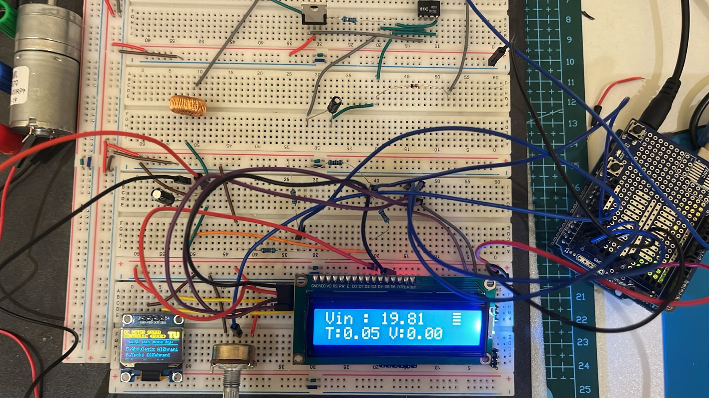

# Arduino-Controlled Buck Converter for DC Motor Speed Control

A power electronics project that uses a buck converter to adjust the voltage supplied to a DC motor. The design was simulated in Proteus and built as a breadboard prototype using an Arduino Uno.

## Circuit Design

A potentiometer sets the desired output voltage. The Arduino adjusts the switching signal using output-voltage feedback, while the LC filter smooths the voltage supplied to the motor. The LCD displays the input, target, and output voltages.

## Main Components

| Component | Role / Value |
| --- | --- |
| Arduino Uno R3 | Controller for the hardware prototype |
| IR2101 | High-side MOSFET gate driver |
| IRFZ44N | Power MOSFET |
| Inductor | 100 µH |
| Output capacitor | 100 µF in the simulation |
| Voltage dividers | 10 kΩ / 1 kΩ |
| Potentiometer | Sets the target voltage up to 12 V |
| LCD / OLED | Voltage display / team credits |

## Hardware Prototype

The prototype was tested with an input supply of approximately **19.86 V** and target voltages from **0 to 12 V**.

## Experimental Readings

| Target (V) | Input (V) | Displayed Output (V) |
| ---: | ---: | ---: |
| 0.00 | 19.86 | 0.00 |
| 3.00 | 19.86 | 3.00 |
| 6.01 | 19.86 | 6.01 |
| 9.00 | 19.85 | 9.00 |
| 12.00 | 19.86 | 12.00 |

These are recorded display readings; the display rounds the output to the target within a 0.8 V difference. The near-maximum photograph shows 11.99 V.

## Project Files

| File / Folder | Contents |
| --- | --- |
| [Arduino sketch](firmware/sketch_may16a/sketch_may16a.ino) | Controller code |
| [Proteus project](simulation/copyProject.pdsprj) | Editable circuit design |
| [Images](docs/images/) | Schematic and experiment photographs |
| [Technical notes](docs/PROJECT-NOTES.md) | Wiring differences and verification notes |

## Team

I worked on this project as part of a team with **Abdullah, Osama, Majed, Faisal, Abdulaziz, and Omar**.
